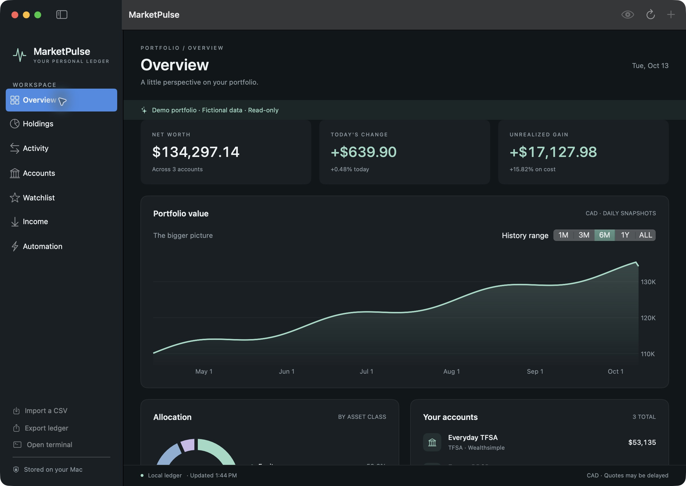

# Native macOS app

MarketPulse now includes a full SwiftUI portfolio window alongside its menu bar.
It uses your existing SQLite ledger through the Python CLI. Requires macOS 14+.
`MarketPulse.app` [built with its own backend](#build-the-standalone-app) needs
nothing else; installing from a checkout needs the Xcode Command Line Tools and an
editable source checkout.

## Install from this checkout

```bash
uv tool install --python 3.11 --editable .
marketpulse desktop install
```

The installer builds and opens `~/Applications/MarketPulse Bar.app`. Desktop
installation adds a Dock presence. `marketpulse menubar install` installs the
same interface as a menu bar utility. The menu bar's **Portfolio** button opens
the full window. Both install paths replace the same bundle.

The installer records the absolute CLI path and any `MARKETPULSE_DATA` directory
and `MARKETPULSE_CONFIG` file overrides. Reinstall after moving the checkout or
changing which portfolio/configuration the app should use. Installing with no
overrides resets it to the default paths. Launch-at-login preferences remain
under your control in **Settings › General**.

## Build the standalone app

`MarketPulse.app` carries its own Python, so it runs on a Mac with no Python, uv, or
Xcode tools. Building it needs uv and the Swift toolchain:

```bash
uv sync --locked --dev
uv run --locked python scripts/build_app.py                        # this Mac's architecture
uv run --locked python scripts/build_app.py --arch arm64 --arch x86_64
```

Each build lands in `dist/app/<arch>/MarketPulse.app` (`--out` changes the folder).
The script builds the wheel, copies a pinned, relocatable CPython
([python-build-standalone](https://github.com/astral-sh/python-build-standalone),
the builds uv installs) into `Contents/Resources/backend/python`, strips what the
engine never uses (Tk, IDLE, the test suite, headers, pip), installs the wheel and
the dependencies pinned in `uv.lock` (with hash checks), and precompiles bytecode.
`Contents/Resources/backend/bin/marketpulse` is a small launcher that runs that
Python in isolated mode, so `PYTHONPATH` or packages from your own Python setup
never leak in. It works from any folder and through a symlink, so you can also
link it onto your `PATH` and use the bundled CLI and TUI.

The script ad-hoc signs every native library inside, then the app (no Developer ID:
MarketPulse ships unsigned builds by decision, see the [App plan](app-plan.md)),
checks `codesign --verify --deep --strict`, and smoke-tests the bundled CLI with an
empty environment and a scratch ledger: version, demo payload, recording a deposit,
and loading the native `curl_cffi` library. An Intel build on Apple Silicon is smoke
tested only if Rosetta is installed; `--skip-smoke` skips the test.

| Build (MarketPulse 2.1.0, Python 3.14.7) | App | Zipped (`ditto -c -k`) |
| --- | --- | --- |
| arm64 | 77 MB | 32 MB |
| x86_64 | 79 MB | 32 MB |

Releases are built by the tag-triggered workflow, not on anyone's Mac: each version's
GitHub Release has the arm64 and x86_64 apps as zips and DMGs, `SHA256SUMS`, and
`install.sh` (see the release checklist in [CONTRIBUTING.md](../CONTRIBUTING.md#maintainer-release-checklist)).
To install a release, see the [install guide](install.md).

The app uses the same data (`~/.marketpulse`) and settings
(`~/.config/marketpulse/config.toml`) as the CLI and TUI, and honours
`MARKETPULSE_DATA` and `MARKETPULSE_CONFIG`. Its bundle ID is `dev.marketpulse.app`,
so its preferences are separate from a checkout install's `MarketPulse Bar.app`.

### Which backend the app runs

1. `MARKETPULSE_CLI`, for development. Apps opened from Finder or `open` don't see
   your shell's variables, so pass it explicitly:
   `open --env MARKETPULSE_CLI="$PWD/.venv/bin/marketpulse" dist/app/arm64/MarketPulse.app`.
2. The bundled backend, in `MarketPulse.app`.
3. The app's own `cliPath` setting. `marketpulse desktop install` records it for
   `MarketPulse Bar.app` (`defaults read dev.marketpulse.bar cliPath`). `MarketPulse.app`
   doesn't read that setting, so a checkout install never changes which engine it runs.
4. `marketpulse` on `PATH`.

**Automation › About MarketPulse** shows the app version, the backend's MarketPulse
and Python versions, and which of these the app is running.

## First run

On a brand-new ledger (no accounts, including archived ones) the portfolio window
opens with a welcome sheet, once. It offers to create the first account, import a
CSV, or explore the demo portfolio, lets you pick the currency totals are shown in
(`base_currency`), and says where the ledger is stored. **Help › Welcome to
MarketPulse** brings it back at any time, and the empty Overview's **Other ways to
start…** button opens it too. The app remembers that it showed the welcome in its
own preferences (`welcomeShown`), not in your ledger.

## Settings

**MarketPulse › Settings…** (⌘,), the popover's gear, or **Automation › Open Settings…**
opens the Settings window. Every change applies straight away, without a restart.

| Tab | Settings | Stored in |
| --- | --- | --- |
| General | Refresh interval, launch at login, [update checks](#update-checks), what the menu bar shows (day change, net worth, or a symbol's price), the terminal app, and the ⌥⌘M shortcut | App preferences; the menu bar display is `menubar_display` / `menubar_symbol` in the config file |
| Appearance | System, Light, or Dark for the portfolio and Settings windows and their sheets | App preferences (`appearance`) |
| Portfolio | The currency totals are shown in, the default account, and privacy mode | Config file: `base_currency`, `default_account`, `privacy` |
| Data | Where the portfolio and the settings file are, with **Reveal in Finder**, the backups kept, and archived accounts to unarchive | — |

Config-file settings are saved with `marketpulse config set`, so the CLI and TUI see
the same values. The default account is preselected when you record a transaction
and saved by name (by id for a name made only of digits, which the CLI reads as an id);
an id or account type written by the CLI works too. In the demo, Settings is read-only. The menu bar's popover keeps the
colours of your MarketPulse terminal theme (`marketpulse theme set`).

## Update checks

The app downloaded from GitHub Releases checks for a newer version at most once a day,
while it runs. When there is one, the portfolio window shows a banner, the app menu
gains **Update Available**, and the menu bar popover gets a line. Each offers the release
notes and **Copy Install Command**: the [one-line install](install.md#update) for that
version (with `--dir /Applications` if the app runs from there), to paste into Terminal.
Nothing is downloaded or installed for you, and your portfolio isn't touched. Closing the
banner hides it until the next version. **MarketPulse › Check for Updates…** or
**Settings › General › Check Now** checks straight away.

**What's sent:** one HTTPS `GET` to
`https://api.github.com/repos/BrendanH18/Marketpulse/releases/latest`, with the headers
`Accept: application/vnd.github+json` and `User-Agent: MarketPulse/<app version>`, plus
the standard `Accept-Encoding` and `Accept-Language` headers macOS adds. No cookies,
identifiers, portfolio data, or settings. GitHub sees your IP address, as with any
request. The answer is only compared with the app's version.

**Turning it off:** **Settings › General › Check for updates automatically**. Off means no
request at all, including **Check Now**. The demo never checks. Copies built from a checkout
(`marketpulse desktop install`) never check: update the checkout and run the install again.
Failures (offline, GitHub rate limits) are silent, and the next check is a day later.

For QA, `MARKETPULSE_UPDATE_FEED=<file>` makes the app read a GitHub-style release JSON
from that file instead of contacting GitHub; `scripts/qa_app.py` sets it to a fictional
v99.0.0.

## Workspaces

- **Overview:** net worth, daily change, unrealized gain, snapshot history,
  asset allocation, account balances, and recent activity.
- **Holdings:** search, account filters, value/symbol ordering, and native/base
  currency labels. Missing prices remain unavailable rather than becoming zero.
- **Activity:** searchable ledger entries and amounts in the original currency,
  signed from the account's point of view: **+** money in (sells, deposits,
  income), **−** money out (buys, withdrawals, fees). DRIPs and transfers move
  shares rather than cash and carry no sign; splits show their ratio. Right-click an
  entry to **Edit…** (or double-click it) or **Delete…** (or select it and press Delete).
  Edit opens the transaction form filled in; the type is fixed, so delete the entry and
  record a new one to change it. Buys, sells, deposits, withdrawals, dividends,
  interest, and fees can be edited; transfers, DRIPs, splits, and returns of capital can
  be deleted and recorded again. Any entry can be deleted, after a confirmation. A
  change that would leave a sale of more than was held at the time is refused, with the
  reason, and nothing is changed.
- **Accounts:** create accounts, and **Edit account…** (or right-click) to rename one or
  change its type, currency, institution, or cash tracking. **Archive…** in the same
  sheet hides an account after a confirmation that says what will happen. If the account
  was changed in another window, or the portfolio restored from a backup, since the sheet
  opened, the change is refused and nothing is saved. Contribution
  room for TFSA, RRSP, and FHSA shows what's left; **Set…** or **Update…** enters the
  room CRA reported for January 1 of a year (`marketpulse accounts room`), in Canadian
  dollars.
- **Watchlist:** add/remove symbols and create/delete price or daily-change alerts.
- **Income:** recorded monthly distributions and interest, converted at current FX.
- **Tax:** capital gains for each year with a sale in a taxable account, with the same
  figures as `marketpulse tax`: pooled cost base across your taxable accounts, and
  each trade day's exchange rate. It shows the net and taxable capital gain, any
  denied losses with the reason (a superficial loss shows what was bought back and
  still held), and gains by security; expand a security to see each sale and its full
  fractional quantity. Sales missing an exchange rate are flagged and left out of the
  totals. Contribution room
  shows how what's left was worked out. **Export CSV…** saves the year's sales for
  your accountant (`marketpulse tax --year YYYY --csv FILE`). The report loads when
  you open the workspace and again after the portfolio changes; **Recalculate**
  fetches exchange rates again. Sales in archived accounts still count, as they do
  for CRA, but the account is shown only as "Archived account". The figures are
  estimates, not tax advice: check them against your T5008, T3, and T5 slips.
- **Automation:** what runs while the app is open, a link to Settings, backup action, errors,
  snapshot/backup status, and the app and backend versions. **Backups** lists the
  backups on this Mac with **Restore…** and **Show in Finder**. A restore asks for
  confirmation, saves your current portfolio as a backup first, refuses a damaged
  file or one from a newer version without changing anything, and reloads the window
  ([details](data.md#restore-a-database)).

Use **⌘N** to record a transaction: a buy, sell, deposit, withdrawal, dividend,
interest, fee, reinvested dividend (DRIP), in-kind transfer between your accounts, stock
split (entered as new shares for old, such as 2 for 1, or 1 for 10 for a consolidation),
or return of capital. For a transfer, split, or return of capital the form says how much
of the symbol the account holds now. A transfer between a registered and a
non-registered account needs the market price on its date, because tax treats it as a
sale (or a new cost base); between two accounts of the same kind, shares move at cost
and no price is needed. A transfer or split is checked against what the account held on
its date: one of shares it didn't hold, or that a later sale needs, is refused with the
reason. Use **⌘R** to refresh, **⌘I** to import, and **⌘E**
to export. Import first previews new entries, duplicates, skipped lines, and new
accounts. The preview runs the real import against a temporary copy of your
ledger, so it reports exactly what Import will do. The app imports its own copy
of the file taken when you chose it, so later edits to the file don't apply.
Select a default account for files without an account column. Clicking Import
adds the valid new entries, skipping the reported invalid ones, and takes a
safety backup first.

Archived accounts never appear in the app: not in lists, pickers, holdings,
activity, totals, or the menu bar. Their history stays in the ledger, and income,
realized gains, contribution room, tax reports, and returns still count it. If an archived
account still holds investments or cash, MarketPulse leaves them out of net worth,
warns you, and pauses daily snapshots and history rebuilds so your history never records a false drop;
move or sell them, or unarchive the account. CSV rows that name an archived
account are skipped with that reason, in both the preview and the import.
The one exception is **Settings › Data › Archived accounts**, which lists them only so
you can **Unarchive** one; the Accounts workspace links to it with a count.

Number fields accept your system's format (`12,5` in French or German, as well as
`12.5`). When an entry could be read more than one way, such as `1.000`, the form
shows how it reads it before you save.

Transaction saves have a unique request identity. If the command fails after saving,
the app checks its receipt and confirms "Transaction recorded. Its confirmation failed."
If it cannot check the outcome, the form keeps the original entry locked and offers
**Retry save**, which reuses the same request and cannot add a duplicate. When a receipt
check confirms nothing was saved, you can correct or cancel the entry normally. If you
force-quit during an uncertain save, check Activity before entering it in a new form.

Edits and deletes send the activity row's `revision` (`txn edit --revision`, `txn delete
--revision`), so an entry that changed since the window loaded it is refused with "has
changed since it was loaded" instead of being overwritten; refresh and try again.

For clients using the CLI, transaction commands accept `--request-id <uuid>`;
`marketpulse desktop transaction-status <uuid>` returns `recorded` and `transaction_id`
without fetching prices. Reusing an ID with a different command or arguments is refused.
Receipts are stored atomically with entries in SQLite's existing `meta` table, retained
even if an entry is edited/deleted, and included in backups. No schema migration is
required. Commands without a request ID keep their existing output and exit behavior.

Privacy mode masks portfolio amounts and quantities, and hides amount-bearing
charts. Quotes and percentage changes remain visible. CSV and JSON exports
contain the original data. The portfolio window has light and dark palettes
(**Settings › Appearance**); the menu bar continues to follow configured Omarchy themes.

Advanced asset definitions, editing transfers, DRIPs, splits, and returns of capital
(the app records and deletes them), and historical backfills
remain in the CLI/TUI. Portfolio charts show net worth,
which includes contributions; they are not a time-weighted return chart.

## Automation

While the app runs, every refresh checks quotes and alerts, records a daily
snapshot when valuation is fresh and complete, and takes a daily backup when
the latest backup is at least 24 hours old. Missing or stale prices are visible;
stale quotes do not fire alerts or create performance snapshots.

If the portfolio window's data can't be refreshed, the menu bar falls back to
`marketpulse status --json` and keeps working; the window shows the error.

Closing the window leaves the menu bar running. Click the Dock icon, choose
**Open Portfolio** (⌘0), or use the menu bar's **Portfolio** button to bring it back. Quitting the app stops its
maintenance timer. Only enable **Settings › General › Launch at login** if you want that behavior.
For a terminal worker or an external scheduler:

```bash
marketpulse automation run --interval 60
marketpulse automation run --once --json
marketpulse automation run --once --json --quiet
```

Continuous execution retries failed cycles at the next interval. One-shot runs
exit nonzero only when the cycle fails (for example, the backup couldn't be
written). A symbol or exchange rate the provider can't quote is listed under
`quote_errors` and doesn't fail the run. Use one worker per ledger to
avoid duplicate alert notifications. Automation does not create ledger entries.
Backups are local; see [data and restoration](data.md) for retention and recovery.

## Read-only demo

In the app, choose **Help › Explore a Demo Portfolio** (or the option on the welcome
sheet). The window and menu bar switch to a fictional portfolio with a "Demo" banner
and a **Leave demo** button; writes, refreshes on a timer, and the terminal are off
until you leave. The demo is built in a temporary folder by
`marketpulse desktop snapshot --demo` (and `desktop tax --demo` for the Tax workspace),
so your ledger isn't read or changed.

For screenshots and QA, build without installing, then launch the app in the demo for
the whole session (it has no way back to a real ledger):

```bash
uv sync --locked --dev
swift build --package-path macos/MarketPulseBar
NATIVE_BIN="$(swift build --show-bin-path --package-path macos/MarketPulseBar)"
MARKETPULSE_CLI="$PWD/.venv/bin/marketpulse" \
  "$NATIVE_BIN/MarketPulseBar" --demo
```



`swift build --show-bin-path --package-path macos/MarketPulseBar` prints the actual
binary directory if your toolchain uses another layout. The demo disables data
writes and notifications and never opens your real portfolio or fetches quotes.
All demo values and history are fictional.

For integration checks, `marketpulse desktop snapshot --demo` emits the same
versioned JSON used by the app, and `marketpulse desktop tax --demo` the Tax
workspace's report. This bridge includes raw financial amounts even
when privacy mode is enabled, just like the existing `status --json` API.
